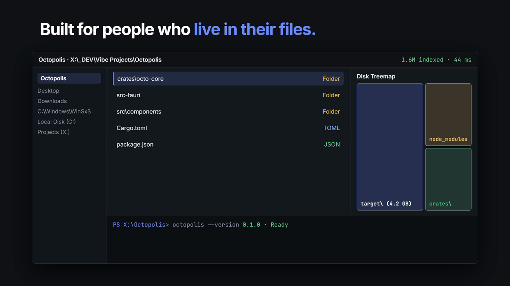
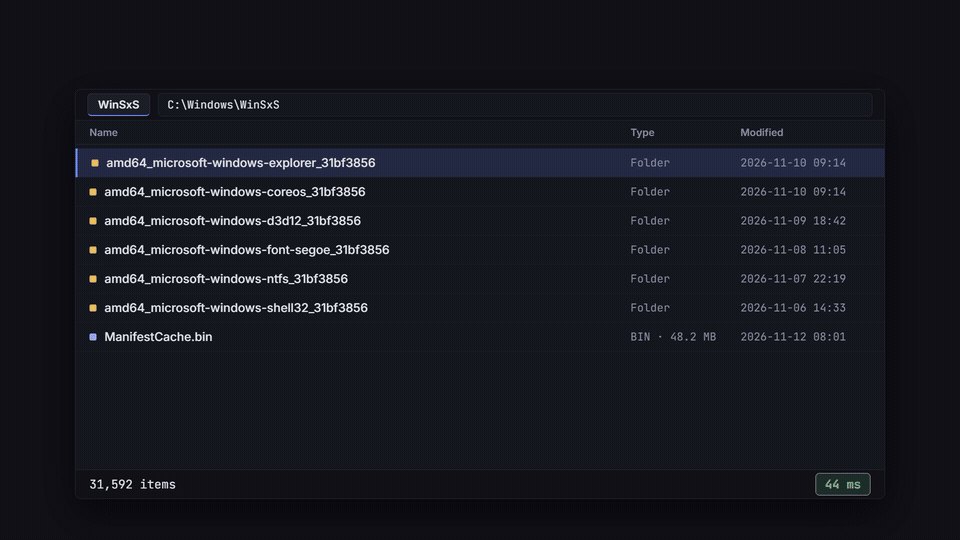
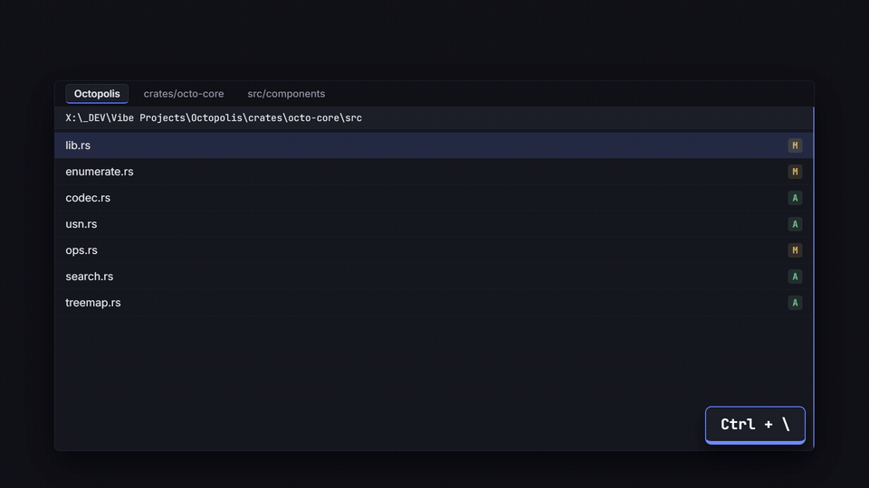
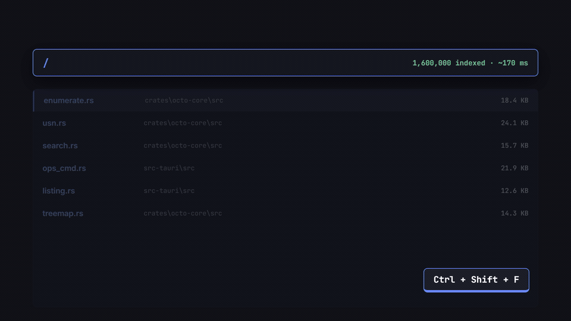
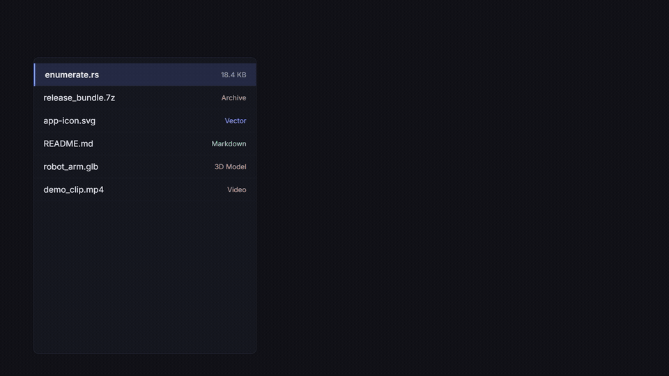
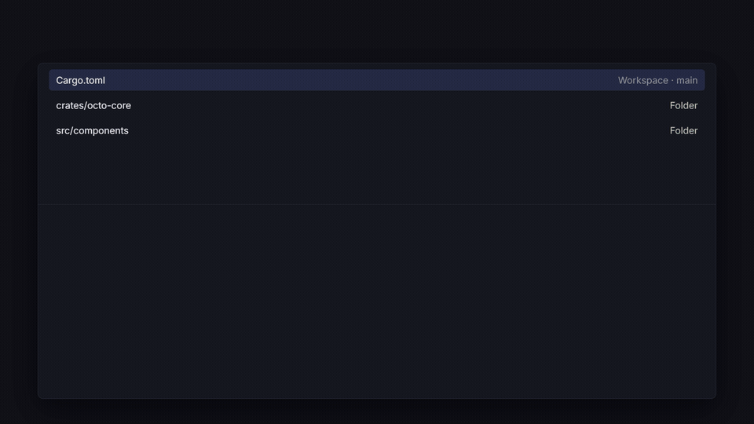

<p align="center">
  
</p>

<h1 align="center">octopolis</h1>

<p align="center">
  <b>A blazing-fast, keyboard-first file explorer for Windows — built for people who live in their files.</b>
</p>

<p align="center">
  
  
  
</p>

<p align="center">
  
</p>

---

## Feature Highlights

### ⚡ Instant 100k+ Item Folders
A native Rust engine streams directory entries directly from Windows (`FindFirstFileExW`) so even massive folders like `C:\Windows\WinSxS` (31,000+ items) open in milliseconds and scroll at full refresh rate.

<p align="center">
  
</p>

### 🪟 Tabs, Split Panes & Drag-and-Drop
Open tabs in any pane, split side-by-side (`Ctrl+\`) or stacked (`Ctrl+Shift+\`), sync navigation across panes, drag files onto breadcrumb segments or between panes, and collect items across folders in the **Shelf**.

<p align="center">
  
</p>

### 🔍 1.6M-Item Subfolder Search & Smart Filters
Powered by an NTFS USN journal indexer and fuzzy matching (`Ctrl+Shift+F`), search across whole drives with filters like `ext:rs,ts`, `size:>10mb`, `dm:week`, `re:`, and `type:dir` — or switch to **Flat View** (`Ctrl+Shift+E`) to browse every nested file in one list.

<p align="center">
  
</p>

### 👁️ Rich Inspector & Archive Browsing
Press `Space` or `Ctrl+I` to preview syntax-highlighted code, Markdown, images, SVG, PDF, video, audio waveforms, 3D models (`OBJ`, `STL`), and hex dumps — or pin the Inspector to keep a reference open while browsing. Browse `.zip`, `.7z`, and `.tar` archives just like folders.

<p align="center">
  
</p>

### ⌨️ Command Palette & Synced Terminal
Jump to any folder, run commands, calculate expressions, or assign shortcuts straight from the Command Palette (`Ctrl+P` / `Ctrl+Shift+P`). Toggle the built-in terminal (``Ctrl+` ``) that follows your current folder — and updates the file list when you `cd`.

<p align="center">
  
</p>

---

## Everything Else Built In

- **Smart Views & Auto View**: Details, List, Tiles, Content, Columns (Miller), Grid, and **Bento** media view — with **Auto View** picking the best layout per folder (and always Details for code repositories).
- **Safe Transfer Queue**: Background copy/move with pause & resume, speed limits, BLAKE3 checksum verification, side-by-side **Conflict Dialog** with image previews, and error summaries so one locked file never aborts a batch.
- **Power Tools**: Batch rename with live conflict preview, Undo/Redo (`Ctrl+Z` / `Ctrl+Y`), **Lock Hunter** (see and end processes holding a file), **Disk Space Treemap** (`Ctrl+Shift+M`), **Folder Rules**, and **Custom Actions** with 20+ presets.
- **Developer Ready**: Git status badges, current branch & optional last-commit column, optional **Vim keys**, rebindable chorded shortcuts (`Ctrl+K Ctrl+S`), and searchable **Settings** (`Ctrl+,`).
- **Themes & Built-in Guide**: 12+ built-in themes, a full **Theme Editor** with contrast warnings, custom Material icon weights/styles, and an offline interactive **Guide** (`F1`).

---

## Keyboard Shortcuts

| Action | Keys |
| :--- | :--- |
| New tab / close tab / reopen closed | `Ctrl+T` / `Ctrl+W` / `Ctrl+Shift+T` |
| Next / previous tab | `Ctrl+Tab` / `Ctrl+Shift+Tab` |
| Split right / split down | `Ctrl+\` / `Ctrl+Shift+\` |
| Switch pane | `Tab` or `F6` |
| Edit path / quick filter | `Ctrl+L` / `Ctrl+F` |
| Back / forward / up | `Alt+Left` / `Alt+Right` / `Alt+Up` or `Backspace` |
| Copy / cut / paste | `Ctrl+C` / `Ctrl+X` / `Ctrl+V` |
| Rename (or batch rename) / new folder | `F2` / `Ctrl+Shift+N` |
| Delete / delete permanently | `Delete` / `Shift+Delete` |
| Select matching pattern | `Ctrl+Shift+A` |
| Copy path / show hidden / sidebar | `Ctrl+Shift+C` / `Ctrl+H` / `Ctrl+B` |
| Go to folder / all commands | `Ctrl+P` / `Ctrl+Shift+P` |
| Search subfolders / flat view | `Ctrl+Shift+F` / `Ctrl+Shift+E` |
| Inspector / synced terminal | `Ctrl+I` or `Space` / ``Ctrl+` `` |
| Disk treemap / folder sizes | `Ctrl+Shift+M` / `Ctrl+Shift+S` |
| Undo / redo | `Ctrl+Z` / `Ctrl+Y` |
| Details / grid / columns / bento | `Ctrl+1` / `Ctrl+2` / `Ctrl+3` / `Ctrl+Shift+9` |
| Keyboard shortcuts / settings / guide | `Ctrl+K Ctrl+S` / `Ctrl+,` / `F1` |

---

## Install

Download the latest `Octopolis_x.y.z_x64-setup.exe` from the [Releases](../../releases) page and run it. Octopolis requires **Windows 10 or 11**.

### Build from Source

```powershell
# Prerequisites: Node.js, Rust toolchain, Tauri v2 CLI
npm install
npm run build
npm test
```

## License

MIT
