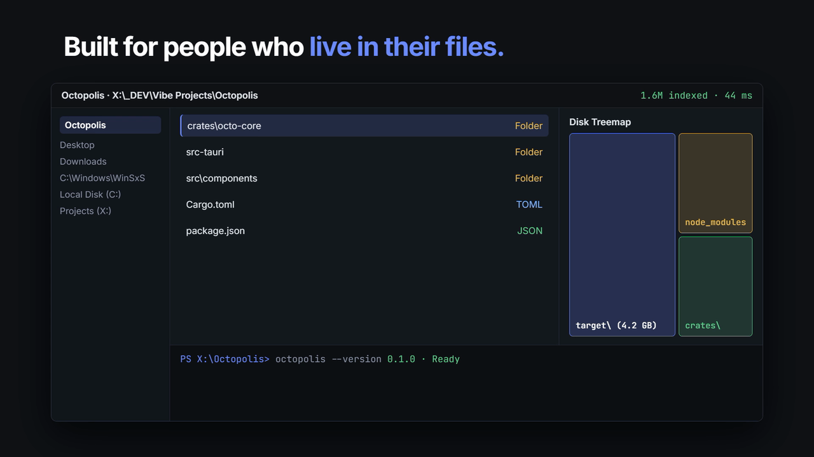
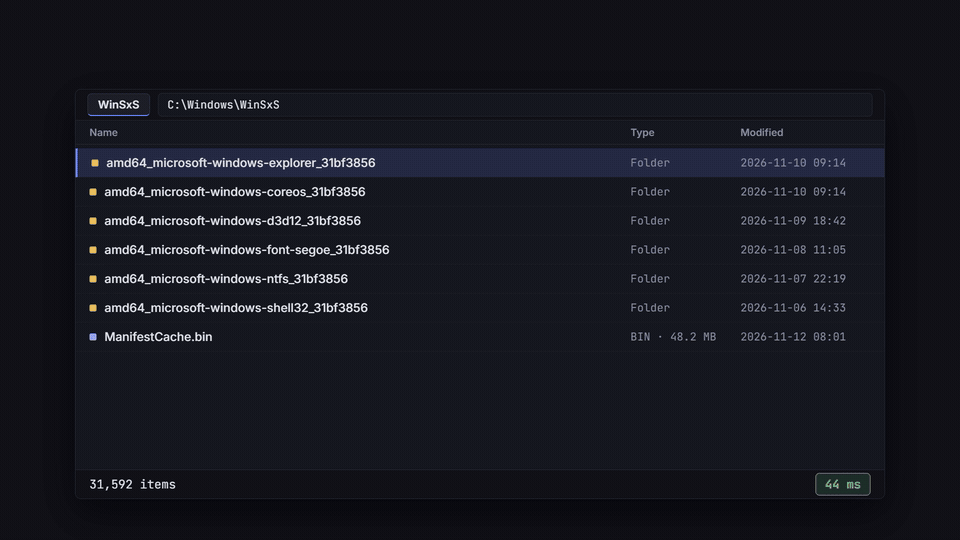
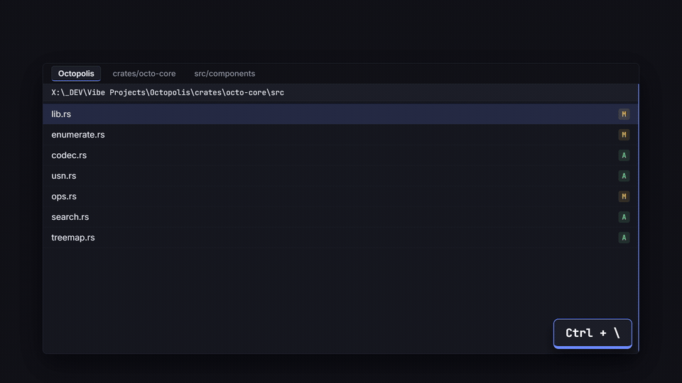
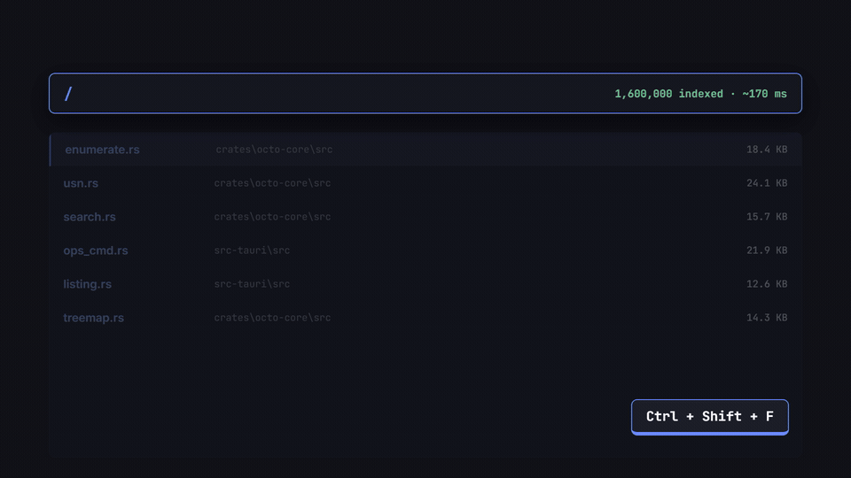
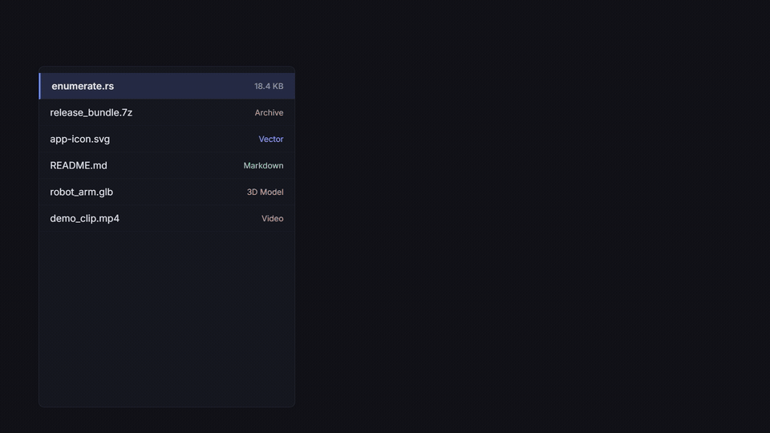
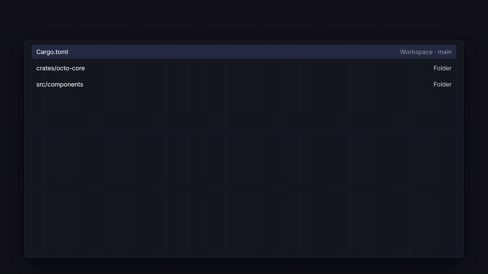

<div align="center">


# Octopolis

**A blazing-fast, keyboard-first file explorer for Windows — built for people who live in their files.**

<br />

[](#install)
[](#build-from-source)
[](LICENSE)

<br />

[**Download**](https://github.com/giran03/Octopolis/releases/latest) &nbsp;·&nbsp; [**Feature Tour**](https://giran03.github.io/Octopolis/) &nbsp;·&nbsp; [**Shortcuts**](#-keyboard-shortcuts) &nbsp;·&nbsp; [**Changelog**](CHANGELOG.md)

<br />



</div>

<br />

## ✨ Why Octopolis?

|  |  |
| :--- | :--- |
| ⚡ **Native speed** | A Rust engine streams directories straight from Windows. 100k+ item folders open in milliseconds. |
| ⌨️ **Keyboard-first** | Everything is reachable from the Command Palette, and every shortcut is rebindable. |
| 🧰 **Power tools built in** | Tabs, split panes, transfer queue, batch rename, Lock Hunter, disk treemap, terminal. |
| 🎨 **Yours to shape** | 12+ themes, a full Theme Editor, custom icon styles, and an offline interactive guide. |

<br />

## 🚀 Feature Highlights

### ⚡ Instant 100k+ Item Folders
A native Rust engine streams directory entries directly from Windows (`FindFirstFileExW`), so even massive folders like `C:\Windows\WinSxS` (31,000+ items) open in milliseconds and scroll at full refresh rate.

<p align="center">
  
</p>

### 🪟 Tabs, Split Panes & Drag-and-Drop
Open tabs in any pane, split side-by-side (`Ctrl+\`) or stacked (`Ctrl+Shift+\`), sync navigation across panes, drag files onto breadcrumb segments or between panes, and collect items across folders in the **Shelf**.

<p align="center">
  
</p>

### 🔍 1.6M-Item Subfolder Search & Smart Filters
Powered by an NTFS USN journal indexer and fuzzy matching (`Ctrl+Shift+F`), search across whole drives with filters like `ext:rs,ts`, `size:>10mb`, `dm:week`, `re:`, and `type:dir` — or switch to **Flat View** (`Ctrl+Shift+E`) to browse every nested file in one list.

<p align="center">
  
</p>

### 👁️ Rich Inspector & Archive Browsing
Press `Space` or `Ctrl+I` to preview syntax-highlighted code, Markdown, images, SVG, PDF, video, audio waveforms, 3D models (`OBJ`, `STL`), and hex dumps — or pin the Inspector to keep a reference open while browsing. Browse `.zip`, `.7z`, and `.tar` archives just like folders.

<p align="center">
  
</p>

### ⌨️ Command Palette & Synced Terminal
Jump to any folder, run commands, calculate expressions, or assign shortcuts straight from the Command Palette (`Ctrl+P` / `Ctrl+Shift+P`). Toggle the built-in terminal (``Ctrl+` ``) that follows your current folder — and updates the file list when you `cd`.

<p align="center">
  
</p>

<br />

## 🧩 Everything Else Built In

| | |
| :--- | :--- |
| 🗂️ **Smart Views** | Details, List, Tiles, Content, Columns (Miller), Grid, and **Bento** media view. **Auto View** picks the best layout per folder, and always Details for code repositories. |
| 🚚 **Safe Transfer Queue** | Background copy/move with pause & resume, speed limits, BLAKE3 checksum verification, a side-by-side **Conflict Dialog** with image previews, and error summaries so one locked file never aborts a batch. |
| 🛠️ **Power Tools** | Batch rename with live conflict preview, Undo/Redo, **Lock Hunter** (see and end processes holding a file), **Disk Space Treemap**, **Folder Rules**, and **Custom Actions** with 20+ presets. |
| 👩‍💻 **Developer Ready** | Git status badges, current branch & optional last-commit column, optional **Vim keys**, rebindable chorded shortcuts (`Ctrl+K Ctrl+S`), and searchable **Settings** (`Ctrl+,`). |
| 🎨 **Themes & Guide** | 12+ built-in themes, a full **Theme Editor** with contrast warnings, custom Material icon weights/styles, and an offline interactive **Guide** (`F1`). |

<br />

## ⌨️ Keyboard Shortcuts

<details open>
<summary><b>Tabs & panes</b></summary>

| Action | Keys |
| :--- | :--- |
| New tab / close tab / reopen closed | `Ctrl+T` / `Ctrl+W` / `Ctrl+Shift+T` |
| Next / previous tab | `Ctrl+Tab` / `Ctrl+Shift+Tab` |
| Split right / split down | `Ctrl+\` / `Ctrl+Shift+\` |
| Switch pane | `Tab` or `F6` |

</details>

<details open>
<summary><b>Navigation & search</b></summary>

| Action | Keys |
| :--- | :--- |
| Edit path / quick filter | `Ctrl+L` / `Ctrl+F` |
| Back / forward / up | `Alt+Left` / `Alt+Right` / `Alt+Up` or `Backspace` |
| Go to folder / all commands | `Ctrl+P` / `Ctrl+Shift+P` |
| Search subfolders / flat view | `Ctrl+Shift+F` / `Ctrl+Shift+E` |

</details>

<details>
<summary><b>File operations</b></summary>

| Action | Keys |
| :--- | :--- |
| Copy / cut / paste | `Ctrl+C` / `Ctrl+X` / `Ctrl+V` |
| Rename (or batch rename) / new folder | `F2` / `Ctrl+Shift+N` |
| Delete / delete permanently | `Delete` / `Shift+Delete` |
| Select matching pattern | `Ctrl+Shift+A` |
| Copy path | `Ctrl+Shift+C` |
| Undo / redo | `Ctrl+Z` / `Ctrl+Y` |

</details>

<details>
<summary><b>View & tools</b></summary>

| Action | Keys |
| :--- | :--- |
| Show hidden / sidebar | `Ctrl+H` / `Ctrl+B` |
| Inspector / synced terminal | `Ctrl+I` or `Space` / ``Ctrl+` `` |
| Disk treemap / folder sizes | `Ctrl+Shift+M` / `Ctrl+Shift+S` |
| Details / grid / columns / bento | `Ctrl+1` / `Ctrl+2` / `Ctrl+3` / `Ctrl+Shift+9` |
| Keyboard shortcuts / settings / guide | `Ctrl+K Ctrl+S` / `Ctrl+,` / `F1` |

</details>

<br />

## 📦 Install

1. Download the latest `Octopolis_x.y.z_x64-setup.exe` from the [**Releases**](../../releases/latest) page.
2. Run the installer.

> [!NOTE]
> Octopolis requires **Windows 10 or 11** (x64).

### Build from Source

Prerequisites: [Node.js](https://nodejs.org), the [Rust toolchain](https://rustup.rs), and the [Tauri v2 prerequisites](https://v2.tauri.app/start/prerequisites/) for Windows.

```powershell
npm install        # install dependencies
npm run tauri dev  # run the app with hot reload
npm run build      # type-check and build the frontend
npm test           # run the test suite
```

<br />

## 📄 License

Released under the [MIT License](LICENSE).

<div align="center">
<sub>Built with Tauri, Rust, and SolidJS.</sub>
</div>
